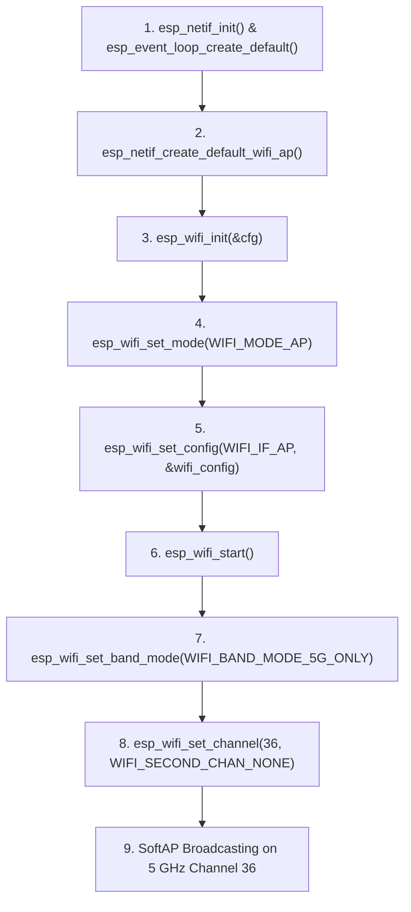

# Configuring 5 GHz Wi-Fi SoftAP on ESP32-C5

This document details how to configure and run the **ESP32-C5** Wi-Fi Access Point (SoftAP) on the **5 GHz band** using ESP-IDF.

---

## 1. Overview & ESP32-C5 Capabilities

The **ESP32-C5** is Espressif's dual-band Wi-Fi 6 (802.11ax) microcontroller SoC, featuring:
* **Dual-Band 2.4 GHz & 5 GHz support** (802.11a/b/g/n/ac/ax).
* **20 MHz and 40 MHz channel bandwidths**.
* **High throughput and lower latency**, ideal for streaming UART serial packets over UDP/TCP.
* **Less channel congestion** in the 5 GHz band compared to crowded 2.4 GHz bands.

---

## 2. Wi-Fi Band Modes in ESP-IDF

ESP-IDF provides three band modes defined in `esp_wifi_types_generic.h`:

| Band Mode Enum | Description | Use Case |
| :--- | :--- | :--- |
| `WIFI_BAND_MODE_5G_ONLY` | Operates **exclusively on 5 GHz channels** (36–165). | SoftAP dedicated to modern 5 GHz devices with high speed and low latency. |
| `WIFI_BAND_MODE_AUTO` | Dual-band auto mode (2.4 GHz + 5 GHz). | Automatic band selection based on connection / channel. |
| `WIFI_BAND_MODE_2G_ONLY` | Operates **exclusively on 2.4 GHz channels** (1–13). | Legacy mode for 2.4 GHz-only devices and longer range. |

---

## 3. 5 GHz Channel Selection & Regulations

Unlike 2.4 GHz (which uses channels 1 to 14), 5 GHz Wi-Fi is divided into distinct frequency sub-bands:

### A. UNII-1 Channels (Recommended for SoftAP)
* **Channels:** `36`, `40`, `44`, `48` (5180 MHz – 5240 MHz).
* **DFS Required:** **No**.
* **Permitted:** Globally permitted for indoor Wi-Fi operation.
* **Recommendation:** **Use Channel 36** as the default SoftAP channel.

### B. UNII-2 & UNII-2 Extended Channels (Channels 52 to 144)
* **DFS Required:** **Yes** (Dynamic Frequency Selection / Radar detection).
* **Recommendation:** **Avoid** for standalone SoftAP mode, as radar scanning delays AP beaconing and can cause unexpected channel hops.

### C. UNII-3 Channels (Channels 149 to 165)
* **Channels:** `149`, `153`, `157`, `161`, `165` (5745 MHz – 5825 MHz).
* **DFS Required:** **No**.
* **Permitted:** Widely allowed in the US, China, and parts of Asia (restricted in some European countries).

---

## 4. ESP-IDF Initialization Sequence

> [!IMPORTANT]
> **API Ordering Rule:**
> In ESP-IDF, `esp_wifi_set_band_mode()` **MUST be called AFTER `esp_wifi_start()`**.
> Calling `esp_wifi_set_band_mode()` before `esp_wifi_start()` returns `ESP_ERR_WIFI_NOT_STARTED`.

### Standard 5 GHz SoftAP Setup Flow:



---

## 5. Complete C Code Example

```c
#include <string.h>
#include "esp_wifi.h"
#include "esp_event.h"
#include "esp_log.h"
#include "esp_netif.h"
#include "nvs_flash.h"

static const char *TAG = "wifi_5g_softap";

#define AP_SSID         "ESP32C5_5G_AP"
#define AP_PASSWORD     "12345678"
#define AP_5G_CHANNEL   36     // UNII-1 standard channel
#define AP_MAX_CONN     4

void wifi_init_softap_5g(void)
{
    // 1. Initialize TCP/IP and default event loop
    ESP_ERROR_CHECK(esp_netif_init());
    ESP_ERROR_CHECK(esp_event_loop_create_default());
    esp_netif_t *ap_netif = esp_netif_create_default_wifi_ap();
    esp_netif_set_default_netif(ap_netif);

    // 2. Initialize Wi-Fi driver
    wifi_init_config_t cfg = WIFI_INIT_CONFIG_DEFAULT();
    ESP_ERROR_CHECK(esp_wifi_init(&cfg));

    // 3. Configure SoftAP parameters
    wifi_config_t wifi_config = {
        .ap = {
            .ssid = AP_SSID,
            .ssid_len = strlen(AP_SSID),
            .channel = 0, // Set to 0 or 1 initially; will be configured to 5G channel post-start
            .password = AP_PASSWORD,
            .max_connection = AP_MAX_CONN,
            .authmode = WIFI_AUTH_WPA2_PSK,
            .pmf_cfg = {
                .required = true,
            },
        },
    };

    if (strlen(AP_PASSWORD) == 0) {
        wifi_config.ap.authmode = WIFI_AUTH_OPEN;
    }

    ESP_ERROR_CHECK(esp_wifi_set_mode(WIFI_MODE_AP));
    ESP_ERROR_CHECK(esp_wifi_set_config(WIFI_IF_AP, &wifi_config));

    // 4. Start Wi-Fi
    ESP_ERROR_CHECK(esp_wifi_start());

    // 5. Configure 5 GHz band mode and channel AFTER start
#if CONFIG_SOC_WIFI_SUPPORT_5G
    ESP_LOGI(TAG, "Configuring Wi-Fi band to 5 GHz Only...");
    ESP_ERROR_CHECK(esp_wifi_set_band_mode(WIFI_BAND_MODE_5G_ONLY));

    ESP_LOGI(TAG, "Setting 5 GHz primary channel to %d...", AP_5G_CHANNEL);
    ESP_ERROR_CHECK(esp_wifi_set_channel(AP_5G_CHANNEL, WIFI_SECOND_CHAN_NONE));

    ESP_LOGI(TAG, "5 GHz SoftAP active. SSID: %s, Channel: %d (5180 MHz)",
             AP_SSID, AP_5G_CHANNEL);
#else
    #error "Current target SoC does not support 5 GHz Wi-Fi"
#endif
}
```

---

## 6. How to Integrate via `menuconfig` (`Kconfig.projbuild`)

In `main/Kconfig.projbuild`, you can expose the band mode and channel options to users:

```kconfig
menu "WiFi Configuration"

    config ESP_WIFI_SSID
        string "WiFi SSID"
        default "myssid"

    config ESP_WIFI_PASSWORD
        string "WiFi Password"
        default "mypassword"

    choice ESP_WIFI_BAND_MODE
        prompt "Wi-Fi Band Mode"
        default ESP_WIFI_BAND_5G
        help
            Select the operating frequency band for ESP32-C5.

        config ESP_WIFI_BAND_5G
            bool "5 GHz Only"

        config ESP_WIFI_BAND_2G
            bool "2.4 GHz Only"

        config ESP_WIFI_BAND_AUTO
            bool "Dual-Band Auto (2.4G + 5G)"
    endchoice

    config ESP_WIFI_CHANNEL
        int "WiFi Channel"
        default 36 if ESP_WIFI_BAND_5G
        default 1 if !ESP_WIFI_BAND_5G
        range 1 165
        help
            WiFi Channel:
            - 2.4 GHz: channels 1 to 13
            - 5 GHz: channels 36, 40, 44, 48 (UNII-1) or 149 - 165 (UNII-3)
endmenu
```

---

## 7. Client Connection & Verification

### Verifying on Windows PC

1. Connect to the SoftAP SSID (e.g. `ESP32C5_5G_AP`).
2. Open **Command Prompt** or **PowerShell** and run:
   ```cmd
   netsh wlan show interfaces
   ```
3. Look for the active network parameters:
   * **Radio type:** `802.11ac` or `802.11ax`
   * **Band:** `5 GHz`
   * **Channel:** `36` (or configured channel)
   * **Receive rate / Transmit rate:** Typically much higher than 2.4 GHz rates (up to 286 Mbps in HT40 / 802.11ax).

### Verifying on Linux
```bash
iw dev wlan0 link
# or
nmcli dev wifi list
```
Check that the BSSID lists `Freq: 5180 MHz` (Channel 36).

### Verifying on macOS
Hold down the **Option (⌥) key** and click the Wi-Fi icon in the top menu bar to display connection details:
* **Channel:** `36 (5 GHz, 20 MHz / 40 MHz)`
* **PHY Mode:** `802.11ax` or `802.11ac`

---

## 8. Troubleshooting & FAQ

#### Q: The client PC / smartphone cannot find the 5 GHz SoftAP SSID.
* Verify that the client device has a **5 GHz-capable Wi-Fi card** (some legacy USB Wi-Fi dongles and older microcontrollers are 2.4 GHz only).
* Ensure you are using **UNII-1 channels (36, 40, 44, 48)**. Channels above 48 often have regulatory restrictions on certain client devices.

#### Q: Does 5 GHz penetrate walls as well as 2.4 GHz?
* 5 GHz provides significantly higher speeds and lower interference, but higher frequency signals attenuate faster through concrete and brick walls. Keep the device within line-of-sight or reasonable distance during testing.

#### Q: How do 802.11 protocols work on 5 GHz?
* When band mode is set to 5 GHz on ESP32-C5, ESP-IDF automatically enables **802.11a/n/ac/ax** protocols by default (`WIFI_PROTOCOL_11A | WIFI_PROTOCOL_11N | WIFI_PROTOCOL_11AC | WIFI_PROTOCOL_11AX`).
